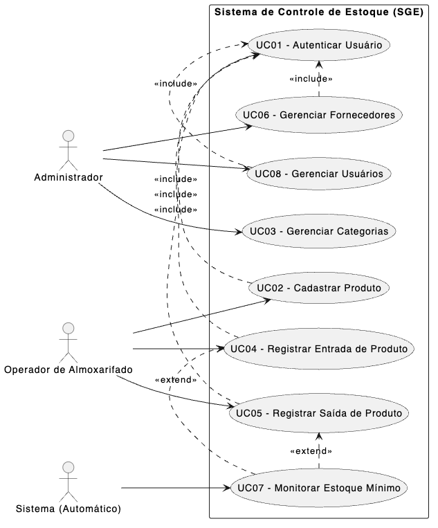
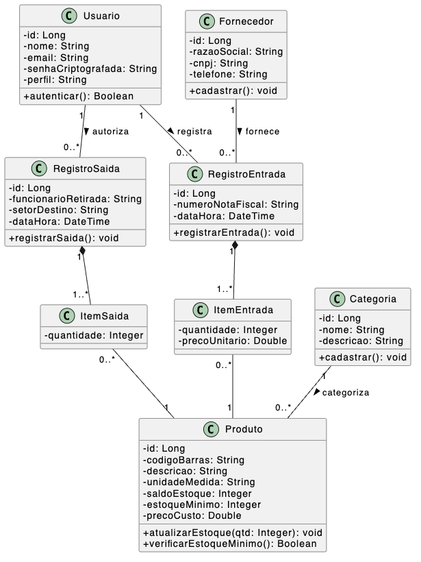
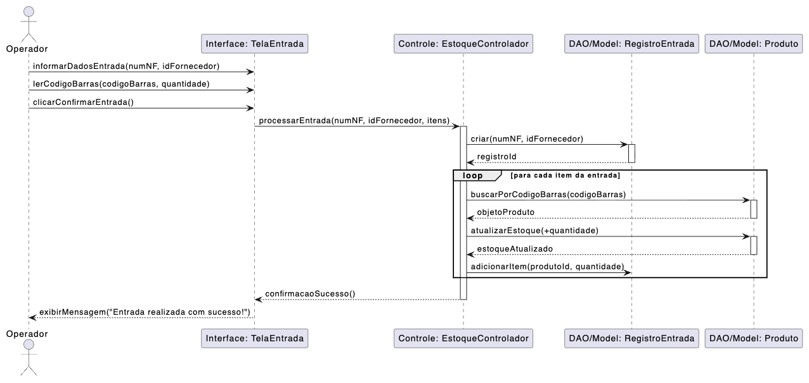
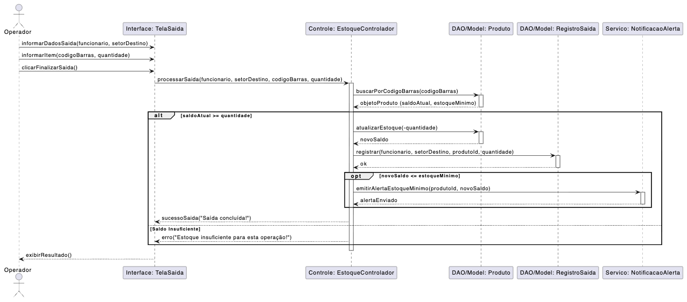

# SISTEMA DE CONTROLE DE ESTOQUE (SGE)

## Documentação de Especificação e Modelagem UML

**Disciplina:** Engenharia de Software / Modelagem UML

**Projeto:** Módulo Integrado de Controle de Estoque e Almoxarifado

**Aluno(a):** Christian de Lima, Pedro G. Santos

**Data:** 2026

## 1. Descrição do Sistema e Requisitos

### Descrição Resumida

O **Sistema de Controle de Estoque (SGE)** tem como objetivo gerenciar de forma automatizada e eficiente o fluxo de materiais e insumos (como materiais de escritório, medicamentos, entre outros) de uma organização. O sistema permite o cadastro detalhado de usuários, produtos associados a códigos de barras, categorização de itens, registro de fornecedores, controle de entradas por notas fiscais e controle rigoroso de saídas (identificando quem retirou o item e para qual setor foi destinado). Além disso, o sistema conta com um módulo automático para monitorar o estoque mínimo e emitir alertas operacionais.

### Usuários Envolvidos

* **Administrador:** Responsável pela gestão de usuários do sistema, cadastro de fornecedores, parametrização e controle geral.

* **Operador de Almoxarifado:** Responsável pelo cadastro de produtos, registro de entradas de mercadorias vindas de fornecedores e registro de saídas.

* **Solicitante / Funcionário:** Colaborador da empresa que realiza a retirada de materiais (identificado no registro de saída).

### Requisitos Funcionais (RF)

| Identificador | Descrição do Requisito Funcional | 
| ----- | ----- | 
| **RF01** | O sistema deve permitir o cadastro, alteração, consulta e inativação de usuários com perfis de acesso (Administrador e Operador). | 
| **RF02** | O sistema deve permitir o cadastro de produtos informando código de barras único, descrição, unidade de medida, preço e categoria. | 
| **RF03** | O sistema deve permitir a categorização de produtos (ex: Material de escritório, Medicamentos, Informática, Limpeza). | 
| **RF04** | O sistema deve permitir o cadastro e gerenciamento de fornecedores (Razão Social, CNPJ, Telefone, E-mail). | 
| **RF05** | O sistema deve registrar a entrada de produtos associada a uma nota fiscal e a um fornecedor cadastrado, atualizando o saldo do estoque. | 
| **RF06** | O sistema deve registrar a saída de produtos informando a quantidade, o funcionário responsável pela retirada e o setor de destino. | 
| **RF07** | O sistema deve controlar o estoque mínimo por produto e emitir alertas automáticos quando o saldo atual for inferior ou igual ao mínimo. | 

### Requisitos Não Funcionais (RNF)

| Identificador | Descrição do Requisito Não Funcional | 
| ----- | ----- | 
| **RNF01** | O sistema deve ser acessível via navegador web moderno com interface responsiva. | 
| **RNF02** | As senhas dos usuários devem ser armazenadas utilizando algoritmos de criptografia fortes (ex: BCrypt). | 
| **RNF03** | O tempo de resposta para operações de consulta de estoque e leitura de código de barras não deve exceder 2 segundos. | 

## 2. Diagrama de Casos de Uso

O diagrama de casos de uso representa as principais interações operacionais dos atores com o sistema SGE.


```
@startuml Diagrama_Casos_de_Uso_SGE
left to right direction
skinparam packageStyle rectangle

actor "Administrador" as Admin
actor "Operador de Almoxarifado" as Operador
actor "Sistema (Automático)" as Sistema

rectangle "Sistema de Controle de Estoque (SGE)" {
    usecase "UC01 - Autenticar Usuário" as UC01
    usecase "UC02 - Cadastrar Produto" as UC02
    usecase "UC03 - Gerenciar Categorias" as UC03
    usecase "UC04 - Registrar Entrada de Produto" as UC04
    usecase "UC05 - Registrar Saída de Produto" as UC05
    usecase "UC06 - Gerenciar Fornecedores" as UC06
    usecase "UC07 - Monitorar Estoque Mínimo" as UC07
    usecase "UC08 - Gerenciar Usuários" as UC08
}

Admin --> UC08
Admin --> UC06
Admin --> UC03

Operador --> UC02
Operador --> UC04
Operador --> UC05

UC02 .> UC01 : <<include>>
UC04 .> UC01 : <<include>>
UC05 .> UC01 : <<include>>
UC06 .> UC01 : <<include>>
UC08 .> UC01 : <<include>>

UC07 .> UC04 : <<extend>>
UC07 .> UC05 : <<extend>>

Sistema --> UC07
@enduml

```

## 3. Documentação dos Casos de Uso Selecionados

### UC02 – Cadastrar Produto

1. **Nome e Identificação:** UC02 – Cadastrar Produto

2. **Objetivo ou Descrição:** Permitir o cadastro de novos produtos no estoque com leitura ou inserção do código de barras e categorização.

3. **Ator Principal:** Operador de Almoxarifado.

4. **Pré-condições:** O operador deve estar autenticado no sistema; a categoria do produto já deve estar cadastrada.

5. **Pós-condições:** Produto cadastrado no banco de dados e disponível para movimentação.

6. **Fluxo Principal de Eventos:**

   1. O operador acessa o menu "Cadastro de Produtos".

   2. O sistema exibe o formulário de cadastro.

   3. O operador lê o código de barras (ou digita manualmente) e preenche a descrição, categoria, unidade de medida e estoque mínimo.

   4. O operador clica no botão "Salvar".

   5. O sistema valida os dados, verifica a unicidade do código de barras e salva o produto.

   6. O sistema exibe mensagem de confirmação.

7. **Fluxo Alternativo e de Exceção:**

   * **5a. Código de barras duplicado:** O sistema identifica que o código de barras já existe no banco de dados, interrompe o cadastro e exibe mensagem de alerta informando a duplicidade.

### UC04 – Registrar Entrada de Produto

1. **Nome e Identificação:** UC04 – Registrar Entrada de Produto

2. **Objetivo ou Descrição:** Registrar a recepção de itens comprados de um fornecedor, atualizando a quantidade do saldo em estoque.

3. **Ator Principal:** Operador de Almoxarifado.

4. **Pré-condições:** O operador deve estar autenticado; os produtos e o fornecedor envolvidos devem estar previamente cadastrados.

5. **Pós-condições:** O saldo dos produtos informados é incrementado e o registro de entrada com a Nota Fiscal fica armazenado para auditoria.

6. **Fluxo Principal de Eventos:**

   1. O operador seleciona a opção "Registrar Entrada".

   2. O sistema solicita o número da Nota Fiscal e o fornecedor.

   3. O operador informa os dados da Nota Fiscal e seleciona o fornecedor.

   4. O operador insere os itens lendo o código de barras e informando a quantidade recebida e preço de custo.

   5. O operador finaliza a entrada.

   6. O sistema atualiza o saldo dos produtos no estoque e salva o histórico de entrada.

7. **Fluxo Alternativo e de Exceção:**

   * **4a. Produto não cadastrado:** Caso o código de barras lido não corresponda a um produto cadastrado, o sistema permite redirecionar para a tela de cadastro rápido de produtos (UC02).

### UC05 – Registrar Saída de Produto

1. **Nome e Identificação:** UC05 – Registrar Saída de Produto

2. **Objetivo ou Descrição:** Registrar a retirada de itens do estoque, associando a movimentação ao funcionário que retirou e ao setor de destino.

3. **Ator Principal:** Operador de Almoxarifado.

4. **Pré-condições:** O operador deve estar autenticado; os produtos solicitados devem possuir quantidade em estoque suficiente.

5. **Pós-condições:** O estoque do item é decrementado, o histórico da saída é gravado e o alerta de estoque mínimo é acionado se a quantidade atingir o limite.

6. **Fluxo Principal de Eventos:**

   1. O operador seleciona "Registrar Saída".

   2. O operador informa o nome/matrícula do funcionário que está retirando e o setor de destino (ex: TI, Recursos Humanos, Enfermagem).

   3. O operador lê o código de barras do produto e insere a quantidade a ser retirada.

   4. O operador confirma a operação.

   5. O sistema verifica a disponibilidade de saldo.

   6. O sistema decrementa a quantidade no estoque, registra a saída e aciona o teste de estoque mínimo.

7. **Fluxo Alternativo e de Exceção:**

   * **5a. Saldo insuficiente:** O sistema alerta que a quantidade solicitada é maior que o saldo disponível e impede o encerramento da saída até o ajuste da quantidade.

## 4. Diagrama de Classes

O diagrama abaixo apresenta as principais classes de domínio do sistema, seus atributos, visibilidade, métodos, cardinalidades e relacionamentos.


```
@startuml Diagrama_de_Classes_SGE
skinparam classAttributeIconSize 0

class Usuario {
  - id: Long
  - nome: String
  - email: String
  - senhaCriptografada: String
  - perfil: String
  + autenticar(): Boolean
}

class Categoria {
  - id: Long
  - nome: String
  - descricao: String
  + cadastrar(): void
}

class Fornecedor {
  - id: Long
  - razaoSocial: String
  - cnpj: String
  - telefone: String
  + cadastrar(): void
}

class Produto {
  - id: Long
  - codigoBarras: String
  - descricao: String
  - unidadeMedida: String
  - saldoEstoque: Integer
  - estoqueMinimo: Integer
  - precoCusto: Double
  + atualizarEstoque(qtd: Integer): void
  + verificarEstoqueMinimo(): Boolean
}

class RegistroEntrada {
  - id: Long
  - numeroNotaFiscal: String
  - dataHora: DateTime
  + registrarEntrada(): void
}

class ItemEntrada {
  - quantidade: Integer
  - precoUnitario: Double
}

class RegistroSaida {
  - id: Long
  - funcionarioRetirada: String
  - setorDestino: String
  - dataHora: DateTime
  + registrarSaida(): void
}

class ItemSaida {
  - quantidade: Integer
}

' Relacionamentos
Categoria "1" -- "0..*" Produto : categoriza >
Fornecedor "1" -- "0..*" RegistroEntrada : fornece >
Usuario "1" -- "0..*" RegistroEntrada : registra >
Usuario "1" -- "0..*" RegistroSaida : autoriza >

RegistroEntrada "1" *-- "1..*" ItemEntrada
ItemEntrada "0..*" -- "1" Produto

RegistroSaida "1" *-- "1..*" ItemSaida
ItemSaida "0..*" -- "1" Produto

@enduml

```

## 5. Diagramas de Sequência

### DS01: Diagrama de Sequência – Registro de Entrada de Produto

O diagrama a seguir descreve a movimentação de entrada de produtos associada a um fornecedor e Nota Fiscal.


```
@startuml DS01_Registro_Entrada
actor Operador
participant "Interface: TelaEntrada" as Tela
participant "Controle: EstoqueControlador" as Ctrl
participant "DAO/Model: RegistroEntrada" as RE
participant "DAO/Model: Produto" as Prod

Operador -> Tela: informarDadosEntrada(numNF, idFornecedor)
Operador -> Tela: lerCodigoBarras(codigoBarras, quantidade)
Operador -> Tela: clicarConfirmarEntrada()
Tela -> Ctrl: processarEntrada(numNF, idFornecedor, itens)

activate Ctrl
Ctrl -> RE: criar(numNF, idFornecedor)
activate RE
RE --> Ctrl: registroId
deactivate RE

loop para cada item da entrada
    Ctrl -> Prod: buscarPorCodigoBarras(codigoBarras)
    activate Prod
    Prod --> Ctrl: objetoProduto
    deactivate Prod
    
    Ctrl -> Prod: atualizarEstoque(+quantidade)
    activate Prod
    Prod --> Ctrl: estoqueAtualizado
    deactivate Prod
    
    Ctrl -> RE: adicionarItem(produtoId, quantidade)
end

Ctrl --> Tela: confirmacaoSucesso()
deactivate Ctrl
Tela --> Operador: exibirMensagem("Entrada realizada com sucesso!")
@enduml

```

### DS02: Diagrama de Sequência – Registro de Saída com Verificação de Estoque Mínimo

O diagrama detalha a baixa de um produto no estoque, com verificação de disponibilidade e notificação de estoque mínimo.


```
@startuml DS02_Registro_Saida
actor Operador
participant "Interface: TelaSaida" as Tela
participant "Controle: EstoqueControlador" as Ctrl
participant "DAO/Model: Produto" as Prod
participant "DAO/Model: RegistroSaida" as RS
participant "Servico: NotificacaoAlerta" as Alerta

Operador -> Tela: informarDadosSaida(funcionario, setorDestino)
Operador -> Tela: informarItem(codigoBarras, quantidade)
Operador -> Tela: clicarFinalizarSaida()

Tela -> Ctrl: processarSaida(funcionario, setorDestino, codigoBarras, quantidade)
activate Ctrl

Ctrl -> Prod: buscarPorCodigoBarras(codigoBarras)
activate Prod
Prod --> Ctrl: objetoProduto (saldoAtual, estoqueMinimo)
deactivate Prod

alt saldoAtual >= quantidade
    Ctrl -> Prod: atualizarEstoque(-quantidade)
    activate Prod
    Prod --> Ctrl: novoSaldo
    deactivate Prod
    
    Ctrl -> RS: registrar(funcionario, setorDestino, produtoId, quantidade)
    activate RS
    RS --> Ctrl: ok
    deactivate RS

    opt novoSaldo <= estoqueMinimo
        Ctrl -> Alerta: emitirAlertaEstoqueMinimo(produtoId, novoSaldo)
        activate Alerta
        Alerta --> Ctrl: alertaEnviado
        deactivate Alerta
    end

    Ctrl --> Tela: sucessoSaida("Saída concluída!")
else Saldo Insuficiente
    Ctrl --> Tela: erro("Estoque insuficiente para esta operação!")
end

deactivate Ctrl
Tela --> Operador: exibirResultado()
@enduml

```

## 6. Considerações Finais

O desenvolvimento da modelagem do **Sistema de Controle de Estoque (SGE)** atendeu a 100% dos requisitos propostos pela atividade:

* **Consistência:** Os diagramas de casos de uso, de classes e de sequência mantêm perfeita coerência entre si. Os métodos definidos na camada de domínio coincidem com os chamados efetuados durante as interações de sequência.

* **Atendimento ao Tema:** Foram atendidos os requisitos de categorização (Material de Escritório, Medicamentos, etc.), cadastro de produtos via código de barras, cadastro e integração com fornecedores, além do rastreamento de saídas informando funcionário retirante e setor de destino.

* **Decisões de Modelagem:** Optou-se pela separação entre o registro da transação (ex: `RegistroSaida`) e os itens da transação (`ItemSaida`), permitindo que uma única movimentação de nota ou saída contenha múltiplos itens. O controle de estoque mínimo foi modelado de forma a emitir notificações automatizadas logo após a atualização do saldo.